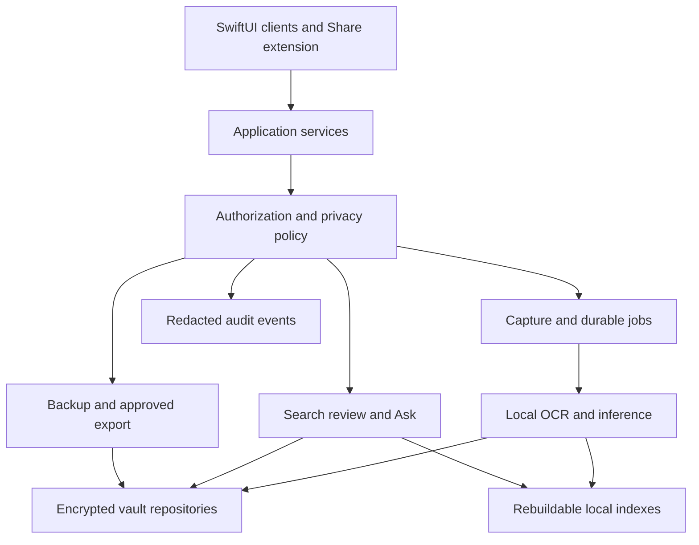

# Mosaic product and architecture plan

Planning baseline 2 October 2026. Status proposed build specification, not evidence of implemented features. Release numbers identify outcome gates, not calendar commitments.

## Product outcome

Mosaic turns screenshots you already take into private, retrievable, source-linked information that you can correct, revisit, act on, and selectively reuse in other projects. It serves iPhone, iPad, and Mac. The original problem is forgetting useful captures, so rediscovery and review are core features, not finishing touches.

The supplied development history indicates an external MacSSD workspace, Git and Xcode setup. This environment has not inspected that Mac repository or validated an existing app. Treat earlier starter-kit tests as historical reports, not current release evidence. First implementation work must inventory the actual repository and reconcile this plan against it.

By v0.4.0 a user can import captures, extract multiple items, correct them, retrieve them, see basic connections, review forgotten items, restore an encrypted backup, and produce a deliberately scoped export. All core workflows work offline. On devices without a supported local LLM, OCR, manual review, exact search, and deterministic connections remain available. Such devices do not receive a silent cloud fallback.

Live sync is deferred to v0.5.0. Through v0.4.0 all three platforms have native clients with independent local vaults. Encrypted snapshot transfer is supported; concurrent multi-device editing and automatic merging are not. If seamless shared state is required for the beta, move that requirement into v0.4.0 and accept a materially longer release.

## Core principles and measurable outcomes

| Principle | Expected behavior | Release evidence |
|---|---|---|
| Capture fits existing habits | Selected import, Share extension, optional screenshot discovery | No mandatory category or title typing at capture |
| Private by default | No content egress without destination-specific consent | Network-denial tests and payload inspection |
| Evidence before inference | Every extracted claim and insight links to its source | Source links survive corrections and exports |
| User controls meaning | Edit, reject, merge, split, undo | Reprocessing never silently replaces corrections |
| Retrieval earns trust | Exact retrieval, filters, grounded answers | Benchmarked questions and explicit insufficient-evidence behavior |
| Rediscovery resolves forgotten intent | Review queue, repeated-interest cues, candidate dates | User completes a realistic review session |
| Knowledge remains portable | Versioned, documented export format | Restore and approved-export round trips |
| Failure preserves data | Durable jobs, transactions, retries, recovery | Fault injection without corrupt committed records |

High-impact information such as college or immigration material is stored as a captured claim, not validated advice. Capture date is not publication date. Relative or yearless dates require confirmation before actionable reminders. Repeated claims do not establish truth; newer screenshots do not automatically supersede older ones.

## Release map

| Version | Product result | Platform commitment | Design maturity |
|---|---|---|---|
| v0.1.0 | Protected capture and retrieval foundation | Mac end-to-end slice; shared domain library | Navigation, terminology, tokens, source detail approved |
| v0.2.0 | Daily native capture and review | iPhone, iPad, Mac core parity | Adaptive layouts, keyboard, accessibility, error states |
| v0.3.0 | Useful local intelligence and rediscovery | Local AI on supported hardware; fallback elsewhere | Connections, evidence, review and Ask interactions validated |
| v0.4.0 | Private beta you can trust with your workflow | All supported devices, encrypted transfer, documented limits | Stable feature-complete design and release QA |

### v0.1.0 Protected foundation

Goal: import one screenshot on Mac, retain it safely, retrieve its OCR, correct its record, delete it, and restore a backup.

Features: selected image import; encrypted owned source copy; local OCR; capture and processing state; basic inbox; record detail with original evidence; editable title/category; full-text search; duplicate hash detection; durable processing queue; lock/unlock; encrypted snapshot backup and restore. All categories initially private. Start with synthetic data until protection gates pass.

Architecture: shared Swift domain types; repository interfaces; explicit SQLite migrations; SQLCipher integration spike; encrypted attachment store; Keychain-backed key management; application services rather than persistence calls inside views.

Design: agree on Inbox, Library, Review, Search and Settings terminology; implement capture cards and source detail; define spacing, type, focus, loading, empty, denied-permission and failed-processing states. AI confidence percentages are excluded until calibrated.

Finalization: the import-to-search flow passes offline; duplicate import is idempotent; interruption and retry do not duplicate captures; encrypted database and attachment inspection reveals no readable content; wrong-key restore fails safely; correct restore preserves records and source hashes; delete removes source, derived search data and cache entries. No unresolved security or data-loss blocker. Migration fixture and rollback-by-backup procedure exist.

Documents: product charter, data dictionary, architecture decisions, threat model, vault/key lifecycle, developer quickstart, v0.1 test evidence and known limitations.

### v0.2.0 Daily capture and review

Goal: use Mosaic routinely on each Apple platform without reorganizing screenshots manually.

Features: iOS/iPadOS clients; selected Photos import; optional screenshot discovery with an explicit initial date/range; Share extension for images and shared text/URLs; foreground scan and opportunistic background jobs; cancel/retry/progress; batch review; collections; user-assigned watch/read/action statuses; edit/undo; confirmed-date reminders; permission and storage management. Receiving a URL does not automatically authorize fetching it.

Functional behavior: limited Photos access remains useful; denied access routes to explicit file/share import; revocation does not crash; originals removed from Photos do not erase owned vault copies; jobs resume after termination. Near-duplicate detection only suggests a match. Users retain distinct crops or updated screenshots.

Design: compact tab navigation on iPhone, sidebar/detail on iPad/Mac; semantic shared components with platform-appropriate interaction. Source and interpretation are distinguishable. Screen-reader labels, Dynamic Type, contrast, keyboard navigation and large interaction targets are checked. Capture takes no mandatory classification step; common review/status actions take at most two interactions after opening a record.

Finalization: agreed device/OS matrix passes; 100-capture interrupted import loses no accepted captures; screenshot discovery does not repeatedly rescan old records; unsupported formats fail visibly; low storage and unavailable external SSD stop writes safely; notification permission denial retains in-app reminders. All main screens have empty, busy, offline, error and recovery states. No blocker or major core-flow defect.

Documents: supported-platform matrix, capture permission guide, accessibility checklist, extension boundaries, job retry rules, synthetic integration corpus and bug triage rules.

### v0.3.0 Local intelligence and rediscovery

Goal: convert captures into useful knowledge and bring it back at the right time.

Features: local text-based structured extraction; multiple entities per capture; summaries; candidate intent/category/actions; source-linked claims; confirmed versus inferred dates; manual entity merge/split; repeated-interest signals; explicit relations; potential-conflict flags; on-demand daily/weekly review queue; local semantic search; grounded Ask answers with clickable evidence. Semantic suggestions and contradiction detection are fallible and labeled as such.

LLM contract: OCR-first baseline; no assumed image-input capability; capability discovery for each provider; typed/schema-validated output; no model-issued SQL or arbitrary filesystem/network execution. Screenshot text is untrusted input, never an instruction to the app. Extraction cannot grant access, change privacy, schedule an unconfirmed deadline or publish data. Model/provider/prompt/schema versions and source spans are recorded. Abstain where evidence is insufficient.

Retrieval: structured filters and exact search establish candidate records; local embedding index broadens retrieval; authorization filters run before content reaches inference; answers cite retrieved records. Embeddings are private derived data. Search indexes are rebuildable. Confirmed entities support joins in SQL; no separate graph database is needed.

Design: one review decision at a time; source evidence accessible next to suggestions; merge preview and undo; explain why an insight appears; distinguish extraction uncertainty from source reliability. Hide AI-only UI when capability is unavailable and explain available alternatives.

Finalization: frozen synthetic/de-identified evaluation set of at least 200 captures across entertainment, reading, college, immigration, technology and other; include list screenshots, crops, low contrast, conflicting dates, instructions embedded in images and unrecognizable content. Proposed targets: schema validity at least 99%; entity precision at least 90%; entity recall at least 85%; all accepted derived records have valid evidence links; all automated tests for unconfirmed high-impact date handling pass. Human review validates numerical metrics. No universal reliability claim follows from this sample.

For 50 predefined search questions, exact known-title searches place the expected record in the top three at least 95% of the time; semantic expected-record retrieval places it in the top five at least 85%. At least 90% of material answer assertions in the test set are supported by cited evidence; any fabricated deadline in the high-impact suite blocks release. Log abstention rates and unsupported assertions, not only successful answers.

Documents: provider contract, extraction schema, evaluation dataset manifest, model card/limitations, retrieval specification, evidence policy, correction precedence and review-ranking rules.

### v0.4.0 Private beta readiness

Goal: the whole intended personal workflow is useful, stable, recoverable and understandable without developer assistance.

Features: all earlier capabilities hardened; onboarding; privacy dashboard; encrypted backup/restore and cross-device snapshot transfer; selective versioned export with preview of records/fields/destination; import validation; portable provenance; grant/revocation UI for future connectors; source/cache storage controls; audit viewer; redacted optional diagnostic bundle; user help and known limitations. Exports default to an encrypted archive; plaintext requires an explicit warning and choice. No live connector is required yet.

Beta journey: capture a manhwa list; obtain several editable entities; discover an existing repeated title; find a college announcement; confirm a candidate deadline; find an OPT screenshot while seeing its unverified status; answer a saved-memory question with evidence; review old items; approve a small entertainment-only export; restore on a second device.

Security gates: deny-by-default tests for every content-read/write/export/inference boundary; no private data in logs/crash reports; locked vault cannot be searched or processed; keys absent from repository and export metadata; network-disabled end-to-end core journey; no unresolved critical/high security finding; dependency and license review; independent review when public distribution is planned. Inspect thumbnails, database journal/WAL files, temporary files, search indexes and extension staging, not only the main database.

Reliability gates: 10,000-record synthetic metadata/search benchmark; 1,000 mixed-image processing stress test; corrupt import and low-space handling; abrupt process termination; source removal; key unavailable; SSD disconnect; index rebuild; backup before every migration; restore after failed migration; every supported prior schema upgrades from a fixture. No unrecoverable committed-data loss in tests. Migration failure leaves the previous vault available through recovery, not partially mutated.

Proposed performance budgets on the declared baseline device: cached first screen p95 under 2 seconds; exact-search response p95 under 300 ms at 10,000 records; local OCR p95 under 5 seconds for a typical readable screenshot. Measure AI extraction separately by device/model; show progress and allow cancellation rather than promise a universal runtime. Define corpus image size and cold/warm conditions in the benchmark report.

Design gates: all core journeys complete without developer coaching in at least four of five observed test sessions; no confusing destructive action; keyboard/VoiceOver/Dynamic Type checks pass; no clipped controls in supported layouts; all substantive UI bugs closed; stable navigation and terminology. A two-week owner dogfood period and a small consenting beta group produce reviewed issues. Aim for 99.5% crash-free sessions, but report sample count; this is a target, not a statistically established promise from a small beta.

Finalization: zero P0/P1 defects; P2 issues only outside core/security/data integrity with a documented workaround and owner; release notes, signed build, recovery guide and evidence bundle complete; product owner explicitly accepts residual limitations. v0.4.0 is a private beta milestone, not an enterprise certification or general-availability claim.

## Architecture

Use a modular native application with one shared Swift package core. Separate modules enable future replacement without the operational burden of microservices.

Modules: MosaicDomain; MosaicPolicy; MosaicStorage; MosaicCapture; MosaicIntelligence; MosaicRetrieval; MosaicReview; MosaicPortability; MosaicAudit; platform UI targets. Dependencies point inward to domain/contracts. UI never directly accesses SQL or model providers. Services check authorization and pass scoped contexts to repositories; storage APIs require vault identity. Local policy is an app-level boundary, not protection against a compromised OS or a privileged developer who modifies the binary.

Persistence choice: SQLite through a Swift repository adapter with explicit migrations, plus a validated SQLCipher build for encrypted full-text storage. This replaces the earlier ambiguous SwiftData-plus-SQLite plan with one source of truth. Validate encryption, FTS behavior, journaling, packaging and license before committing. SwiftData is an alternative only if its search, encryption and migration needs are demonstrated; do not maintain two authoritative databases. Sources are encrypted owned files; thumbnails and embeddings use encrypted storage or remain ephemeral. Indexes inherit vault policy.

Key lifecycle: random vault key, wrapped/stored with appropriate platform Keychain access control; local authentication gates access; app lock stops new work and discards loaded keys where practical. Recovery requires an independently protected recovery mechanism established during backup setup. Do not promise that device-only Keychain keys transfer automatically. Losing every usable key means losing encrypted data. Use established authenticated-encryption libraries; no custom cipher. Specify key rotation, authenticated manifest, backup integrity validation and restore atomicity in an architecture decision.

Import pipeline: received -> staged -> archived -> OCR complete -> extracted -> review ready, with retryable failed/paused states. Persist job IDs, hashes, stage results, retry count and schema/model version. Work commits transactionally. Share extension uses a minimal encrypted app-group staging mechanism with narrowly shared key access and no unrelated vault access; heavy inference belongs in the main app. Default processing concurrency is one; tune after memory/battery tests. User cancellation and unavailable resources checkpoint safely.

Correction precedence: source artifact is immutable; OCR/extraction revisions append; human decisions override machine candidates; reprocessing proposes changes. Near-duplicate detection and entity merging never silently destroy source evidence. Deleting a capture removes its derived rows; shared entities survive while other evidence remains. Tombstones are reserved for later synchronization. Backups retain historical content until explicitly expired; deletion cannot recall copies already exported.

## Data model

| Object | Required meaning |
|---|---|
| Vault | Security boundary, stable ID, owner, schema/key version |
| Capture | ID, vault, ingestion type/time, content hash, privacy class, source locator, processing state |
| SourceArtifact | Encrypted source file, media type, dimensions, hash; optional Photos mapping |
| Observation | OCR span/bounds, raw extracted text, extractor version |
| Entity and Mention | Canonical item plus aliases; capture-specific evidence and proposed identity |
| Claim | Captured assertion, evidence, claimed effective/publication date, verification status |
| Action | Suggested/confirmed task, date interpretation, status, reminder consent |
| Relationship | Endpoints, type, explicit/inferred origin, evidence, confirmation status |
| Collection and UserState | Membership and user's watch/read/review status; separate from source claims |
| Insight | Versioned derived finding with supporting records and rejection state |
| Correction | User change, timestamp and superseded suggestion |
| ProcessingJob | Stage, idempotency key, checkpoint, bounded retry and failure code |
| Grant | Principal, scope, purpose, destination, expiry and revocation |
| AuditEvent | Actor, operation, record IDs, decision and time; no screenshot text |
| ExportManifest | Schema version, authorized fields/IDs, hashes, provenance and export time |

Use UUIDs owned by Mosaic rather than Photos identifiers as primary keys. Cross-device Photos identifiers need mapping and can fail. Owned copies trade storage duplication for recoverable evidence. Never delete Photos originals automatically. Vault-owned source backups and source-linked records remain useful after Photos permissions change.

## Access control

Separate content access from operational authority. In the personal beta, there is one owner; role contracts and negative tests exist, but no fictitious admin organization or login server is necessary. Production roles activate when there is a service or shared workspace.

| Role | Authority | Private content default |
|---|---|---|
| Owner or actual user | Manage own vault, keys, grants, exports and deletion | Own unlocked vault only |
| Delegated reader/editor | Read or change explicitly shared objects | Granted fields/collections only |
| Workspace admin | Manage membership and organization settings later | None through the admin role |
| Super admin/operator | Service deployment, incidents, service availability | None; no universal decryption key |
| Developer | Code, test fixtures, development environments | Synthetic data only |
| QA team | Test builds and approved test datasets | Synthetic or separately consented fixtures |
| Support | Redacted diagnostics and support tickets | None unless user shares a scoped bundle |
| Security/compliance auditor | Configuration, control evidence, sanitized audit events | No source content by default |
| Integration principal | Approved export/API scope and purpose | Narrow, expiring grant only |

Authorization is deny by default. Inputs: principal, vault, operation, record/field scope, destination, purpose, expiry, locked state and privacy restrictions. Check all paths including search snippets, embedding results, thumbnails, inference prompts, export, backup, diagnostics and later sync. Administrative roles cannot create themselves a content grant. Any eventual delegation requires the owner's consent and compatible key distribution. Key-holding collaborators cannot be forced to forget previously decrypted copies.

For a future backend, enforce authorization server-side as well as client-side, tenant/vault isolation, short-lived sessions, MFA for privileged operations, membership removal, rate limits and audited administrative actions. End-to-end encryption means the operator cannot restore lost owner keys or perform server-side plaintext AI; decide this trade-off openly before building sync. An incident override may stop service or revoke tokens, but must not silently grant decryption.

## Security and operations

Threats: device theft, curious operators, agent access to private files, accidental export, prompt injection, malicious imports, logging leaks, dependency compromise, stale claims, destructive migrations, backup loss and future sync conflicts. Protect against these with authentication, encrypted storage, bounded parsers, explicit grants, no LLM execution privileges, transactional migrations, redacted logging, tested backups and key separation. OS compromise and owner-approved exports remain outside a promise of perfect control.

Code and private data stay in separate roots on the MacSSD. Keep the Git workspace, build outputs and synthetic fixtures separate from the app vault, model assets and recovery material. AGENTS.md and gitignore are safeguards, not an OS access boundary. A separate development account with denied vault access offers stronger isolation. On iPhone/iPad use app-contained storage; the Mac external SSD is not a platform-wide storage dependency. Never fall back silently to the Mac internal disk when the selected vault SSD disappears.

Build/release controls: protected main branch when collaboration begins; small reviewed changes; no secrets or private artifacts committed; deterministic migrations; schema/model/prompt versioning; signed platform builds; dependency inventory/SBOM and license review; unit, integration, UI, fault and AI-evaluation jobs. Hosted CI receives synthetic fixtures only. Flags allow disabling a faulty model feature while preserving capture/search. No mandatory analytics; diagnostics are content-free and opt-in.

Local audit events cover exports, grant changes, lock-policy changes, backup/restore, migrations, deletions and extraction revisions. Use minimal identifiers and bounded retention; owner can inspect. A local log is not immutable compliance evidence against the device owner. If enterprise auditing is later required, define an externally anchored append-only evidence system and its privacy policy separately.

Compliance work means a control register, data inventory, retention/deletion policy, consent records, dependency/license review, security incident procedure and accurate user documentation. No SOC 2/GDPR or other certification/compliance claim is implied. Public or enterprise releases require an applicability assessment based on actual users, jurisdiction and data processing; no regulator-specific feature should be invented before that scope exists.

## Documentation and governance

Maintain docs/product.md, roadmap.md, architecture.md, data-dictionary.md, threat-model.md, access-control.md, privacy-and-retention.md, backup-recovery.md, release-checklist.md, support.md and an ADR directory. Every release has an evidence bundle: build ID, schema/model versions, device matrix, test/evaluation results, security findings, known bugs and owner sign-off. Maintain an issue board with requirement -> implementation -> verification -> release mapping.

Definition of done for a feature: user outcome demonstrated, acceptance tests passed, privacy boundary reviewed, accessibility/error states covered, migration/export implications checked, documentation updated, no unresolved core defect. Release candidates freeze new scope; fixes only until gates pass. A missed gate delays the version or removes optional scope explicitly; passing a version label is not a substitute for evidence.

Severity: P0 exposure/data loss/unsafe destructive behavior stops release; P1 crash or unusable core path blocks release; P2 impaired secondary feature needs a workaround and scheduled owner; P3 cosmetic polish may remain. Security severity is tracked independently and critical/high findings block beta. “All bugs fixed” is not a credible gate; known acceptable limitations must be named.

## Delivery sequence and effort

Initial work: inventory Mac repository and device models; adopt this plan in code docs; implement five risk spikes using synthetic data: encrypted SQLite/FTS, backup-key recovery on second device, extension staging, local model structured extraction, and SSD-unavailable recovery. Resolve those before broad UI work.

Build a vertical slice first, then expand platform capture, then intelligence, then beta hardening. Suggested focused developer effort: v0.1 3–5 weeks; v0.2 another 4–6; v0.3 another 5–8; v0.4 another 3–5 including dogfooding. Total 15–24 focused weeks is a planning estimate for one developer with targeted tooling help, not a delivery promise; part-time availability, Swift experience and device tests can extend it. Re-estimate after v0.1. Do not run UI, storage and AI projects independently before their contracts agree.

## Later versions

| Version | Goal | Additional release gate |
|---|---|---|
| v0.5.0 | Opt-in encrypted multi-device sync | Pairing, keys, device revocation, conflict resolution, deletion propagation, offline convergence |
| v0.6.0 | Authorized project interfaces and richer capture | Per-project read scope, expiring tokens, payload preview, rate limits; URL/PDF ingestion with source and content bounds |
| v0.7.0 | Research and recommendation intelligence | Opt-in outbound research, trustworthy provenance, freshness, calibrated preference explanations, cost limits |
| v0.8.0 and beyond | Larger graph reasoning, optional Mac inference service, organizational editions | Measured benefit over simple retrieval; secure pairing; tenant separation; organization key model and audit requirements |
| v1.0.0 | Supported general availability | Longer beta evidence, distribution/privacy review, incident/support capacity, documented compatibility and recovery guarantees |

Possible ambitious work: contradictory claim timelines, multi-source corroboration, personal taste models, domain-specific recommendations, long-horizon synthesis and controlled tools. Each must demonstrate usefulness and avoid turning inferred behavior into asserted personal truth. Do not train models on the private vault or send it to an external provider by default.

## Technical references

Apple Foundation Models availability and text model APIs: https://developer.apple.com/documentation/foundationmodels/generating-content-and-performing-tasks-with-foundation-models and https://developer.apple.com/documentation/foundationmodels/systemlanguagemodel

Apple background scheduling: https://developer.apple.com/documentation/backgroundtasks/choosing-background-strategies-for-your-app

Apple Photos cross-device identifier mapping: https://developer.apple.com/documentation/photos/phcloudidentifier

SQLCipher encryption: https://www.zetetic.net/sqlcipher/

These sources establish platform constraints, not implementation verification. Pin actual SDK/package versions and run the integration spikes before finalizing dependency choices.
