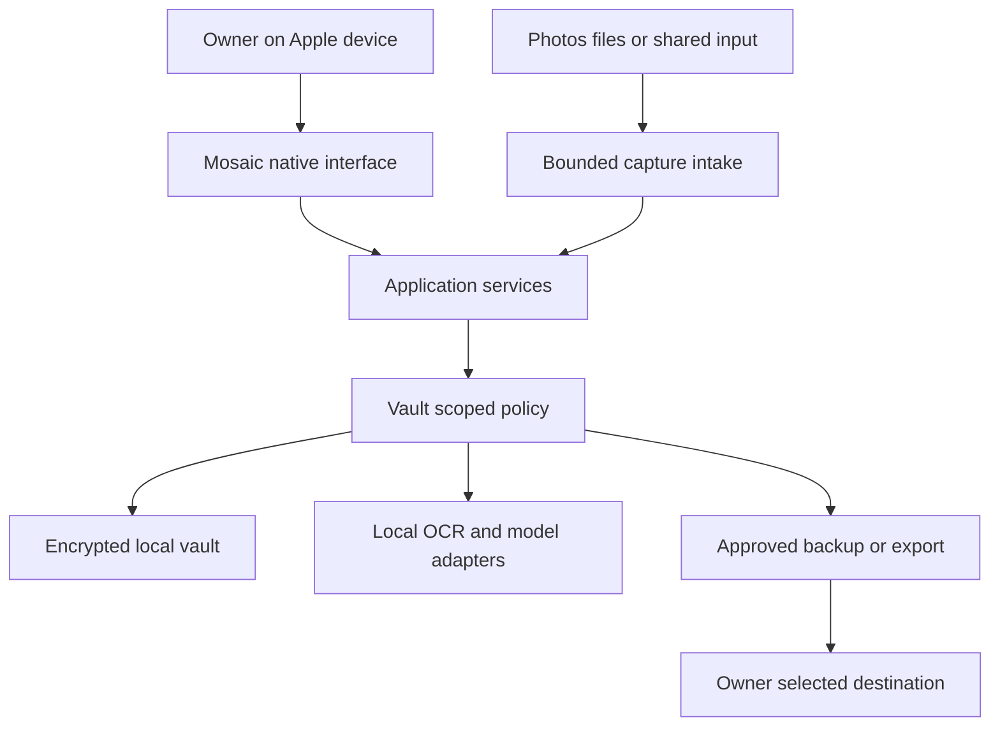

# System architecture

Direction accepted for planning; implementations and package integration remain unverified. MOS-001 reconciles this design with the actual Mac repository. This is a modular native app, not a distributed backend through v0.4.0.

## Context and trust boundaries

Input content is untrusted. OS permission is separate from owner consent to app processing. The repository/agents are outside the private vault boundary. An approved file export crosses a boundary and cannot be revoked retroactively. Photos/iCloud behavior remains governed by its own existing settings.

## Components and dependency direction

| Module | Owns | May depend on |
|---|---|---|
| MosaicDomain | IDs, immutable values, invariants and errors | Swift standard library/Foundation value types |
| MosaicPolicy | Principals, scopes, operation decisions and unlocked sessions | Domain |
| MosaicApplication | Use cases and transactions at service boundaries | Domain and protocol contracts |
| MosaicStorage | SQL repositories, migrations, source/index adapters | Domain, Policy-scoped request types, validated libraries |
| MosaicCapture | Intake, hashing, jobs and Photos adapters | Domain and application interfaces |
| MosaicIntelligence | OCR, provider capabilities, validated extraction | Domain and bounded provider contracts |
| MosaicRetrieval | Exact/filter/vector retrieval and cited answers | Domain, authorized repositories/provider contracts |
| MosaicReview | Ranking, user state and corrections | Domain and repository contracts |
| MosaicPortability | Snapshot, export, import and validation | Domain, policy and storage interfaces |
| MosaicAudit | Redacted events | Domain |
| Platform clients | Views, navigation, permission prompts and entitlements | Application facade; platform frameworks |

Use protocol-based composition at the app root. Protocol declarations live inward; concrete adapters live outward. Views never query SQL or providers directly. Domain must not import SwiftUI, SQLCipher, PhotoKit, Vision or FoundationModels. Do not split each module into a package until that helps dependency enforcement; one shared Swift package with several targets is sufficient.

## Deployment and concurrency

Mac app accesses a user-selected external vault via a validated sandbox/security-scoped mechanism. iPhone/iPad store local app-contained vaults. Share extensions receive only staging access. Dedicated storage actor/serial executor owns database writes; one inference worker initially. UI runs on main actor. Each long operation cooperates with cancellation and lock/session expiration.

No server, remote database, microservices, Kubernetes or browser surface is required. Apple signing and entitlements must be configured on the actual Mac. Hosted CI receives synthetic inputs only; Apple tests require a Mac runner. Automated builds do not gain vault keys.

## Why these choices

SQLite with one authority supports explicit migrations, exact search and portable relational knowledge. FTS is a rebuildable view of canonical data. Entities and relationships form a relational graph first. Owned sources allow durable evidence. Provider abstraction avoids coupling data to one model. Durable jobs accommodate OS scheduling and interruption. ADRs record alternatives and spike results.

## Future sync seam

Record IDs are Mosaic UUIDs; local physical paths never become identity. Preserve revisions and deletion intent. Snapshot restoration is not sync. Before v0.5, decide replica identity, merge rules, encryption/key sharing, tombstones and conflict UX in a new ADR. Do not insert untested automatic CloudKit sync into this architecture.
