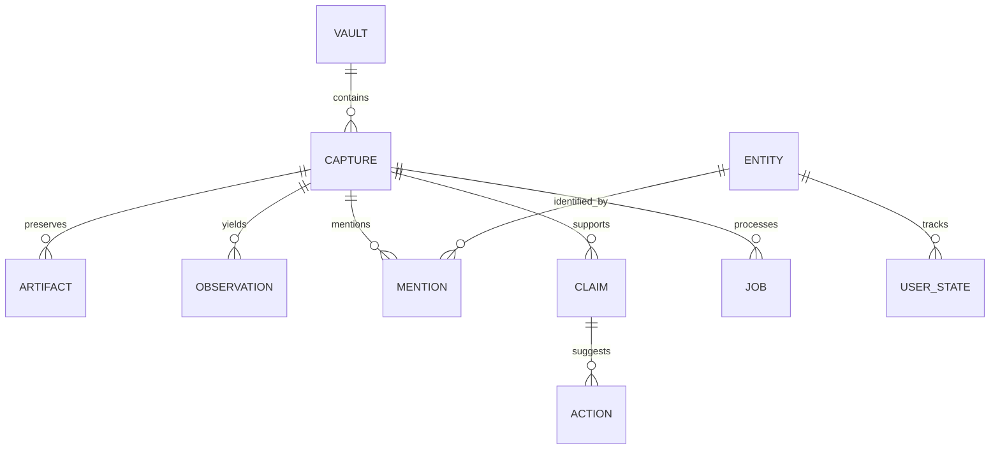

# Domain and persistence model

The SQL file is an executable logical sketch, not an encrypted production migration. It includes the foundational relational constraints and FTS behavior; portability, grants, provider result storage and revision projections are implemented through later reviewed migrations. Do not put real data into a plain SQLite database created from it.

## Main relationships

| Object | Required fields and invariants |
|---|---|
| Vault | UUID, owner principal ID, schema version, key version, created time; one policy boundary |
| Capture | UUID, vault ID, kind, received time, source hash, privacy, category, review state; source hash deduplicates exact input within vault |
| Artifact | UUID, capture/vault, opaque relative encrypted locator, plaintext hash and byte count; hash is private, locator cannot escape vault |
| Observation | UUID, capture/vault, text, revision, OCR engine/version; bounds optional; append rather than overwrite |
| Entity | UUID, vault, canonical name/type; same text is not proof of same identity |
| Mention | UUID, entity/capture/observation, evidence offsets and verification; all foreign keys remain in same vault |
| Claim | UUID, capture/observation, statement, evidence, verification, claimed date metadata; capture timestamp does not imply effective date |
| Action | UUID, optional claim, title, candidate/confirmed date and timezone, reminder consent, user status |
| Relationship | UUID, entity endpoints, type, explicit/inferred origin, evidence set and confirmation; not necessarily objective truth |
| Collection | UUID, vault, label and membership; independent of capture category |
| UserState | Entity, status, user rating/notes/review time; user-owned state separate from extracted facts |
| Correction | Record ID/path, before/after candidate, actor and revision; persist undo lineage |
| Insight | Derivation version, supporting IDs, reason and user disposition; regenerate when dependencies change |
| Job | Durable ID, capture, operation/stage, state, retry/checkpoint and idempotency token |
| Grant | Principal, operations, records/fields, purpose, destination, expiry, revocation; no wildcard default |
| AuditEvent | Actor, decision, operation, opaque record IDs/time; no text payload or secret |

## Canonical types

UUID lowercase canonical strings. All event timestamps are RFC3339 UTC strings. A user date retains local datetime, IANA timezone and original expression; schema validates syntax, application validates timezone and meaning. Strings normalized for search without altering originals. OCR evidence offsets count Unicode scalar values/code points in the stored observation, end exclusive. Swift conversion must not use UTF-16 or grapheme indexes silently. Bounding boxes use normalized coordinates and explicit origin convention; OCR adapter handles conversion.

Capture review state: unreviewed, reviewed, archived. Processing state is independent and lives in jobs. Entity user status: discovered, interested, queued, in_progress, paused, completed, dropped. Information verification: unverified, owner_checked, externally_verified, disputed, outdated. Owner_checked means owner reviewed the saved claim, not that a legal authority verified it.

## Revisions and identity

Original artifact immutable. OCR and extraction append revisions. Current projection combines latest accepted machine data with explicit human overrides. Same source reprocessing is keyed by engine/prompt/schema revisions. Entity merge previews all impacted references, records an alias lineage, and is undoable. Automatic matching suggests candidates; it cannot collapse distinct entities silently. Snapshot imports retain logical IDs but create separate local instance identity.

## Deletion and indexes

Capture deletion removes artifacts, observations, mentions, claims, dependent suggested actions, derived insights and index entries in a coordinated operation. An action independently edited/adopted by the owner must be detached or explicitly handled in the preview before deleting its claim. Shared entity records survive while other mentions exist; user-created entity state may survive by owner choice. SQL sketch cascades actions and illustrates the simpler source-dependent path; production service implements the adopted-action preview distinction before R10.

File/database commit is a saga: stage encrypted artifact, atomically finalize file, commit metadata; orphan sweep handles finalized unreferenced files. Delete transaction first removes logical visibility and schedules file cleanup; durable cleanup retries. Never show a deleted record because file removal failed. Logical deletion is not a promise of physical secure erasure from SSD wear leveling or historical backups.

FTS search_documents is a rebuildable projection containing current accepted title/text. Triggers maintain its FTS table in the sketch. Production applies same transaction to canonical edits and projection updates; interrupted rebuild uses shadow index and atomically switches. Vector caches have engine/dimension/content-version metadata and invalidate on edit/deletion. UUID/vault composite foreign keys prevent cross-vault joins at persistence layer; policy checks are still mandatory.
