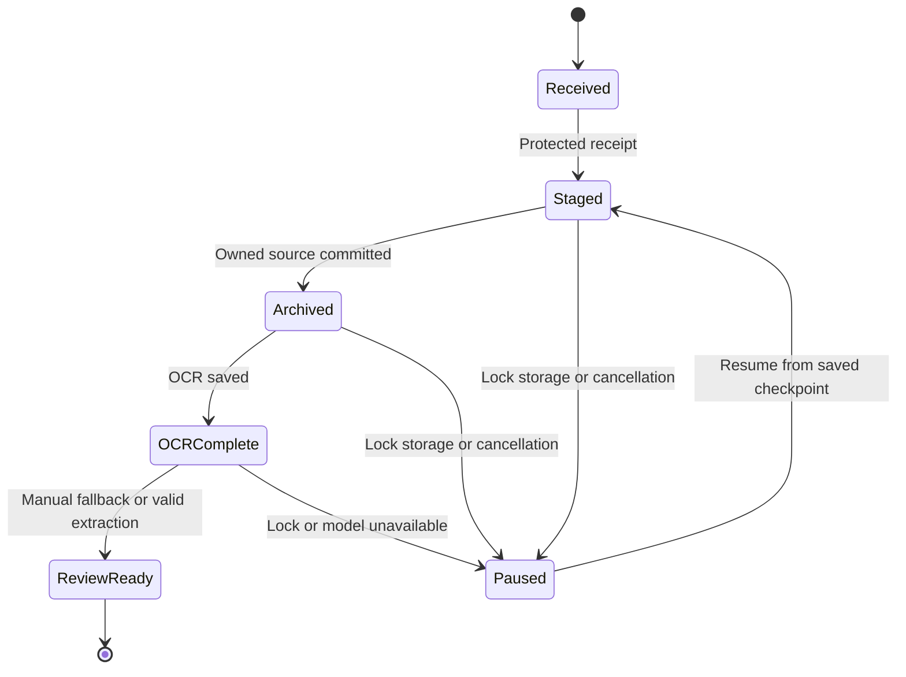

# Capture and processing design

Diagram shows conceptual flow; resume uses actual saved stage, not a forced restart. Jobs have operation, stage and state separately. Failures carry retryable flag/code. Every stage persists durable metadata before advancing; invalid model output leaves OCR/source intact.

## Intake contract

Initial images PNG/JPEG; HEIC capability is a platform spike, enabled only after decoding tests. Draft bounds: max 25 MiB compressed image, max 30 megapixels decoded, batches up to 100 selected items per foreground job set. Values are conservative proposed budgets; measure device memory and document changes. Check decoded dimensions before unbounded allocations; file extension alone is not MIME validation. Share text limited to 100,000 Unicode scalars. URLs are stored, not fetched by default. ZIP/PDF/HTML executable processing is excluded from initial intake.

Accept only after encrypted receipt is durable; show separate “Receiving” before “Saved.” Internal idempotency token covers repeated command delivery; content hash covers exact-byte duplicates. Re-encoded same image may have different hash; perceptual matching is suggestion only. Hashes stay private. Input failure surfaces per item; partial batch completion is legitimate and visible.

## File and transaction ordering

Read bounded input -> validate -> hash -> encrypt staged file -> authenticate/read-back -> atomic file finalize -> database capture/job commit. If crash leaves unreferenced file, orphan sweep identifies it without deleting a referenced source. Source unavailable before protected receipt means not accepted. Database metadata never references a file still being written. Shutdown and SSD disappearance stop work without changing the selected root.

## Photo access

Explicit import is always available. Optional discovery records consented initial date range and last scan checkpoint, supports limited access and does not assume comprehensive library visibility. Rescan relevant assets with durable seen mappings; asset IDs are local references, not Mosaic identity. Mapping and fetch failures leave app-owned source intact. Photos deletion is never automatic.

Photos assets not downloaded locally may require a network retrieval under Photos behavior. Default discovery skips unavailable assets and explains; optional download is a separate owner-approved action, not silent network activity in a local-only claim. Background refresh time is not guaranteed; foreground processing is the correctness path.

## Share extension

Use app-group staging and explicit capability boundaries. Do not share the full vault decryption key with extension code merely for convenience. MOS-005 decides validated staging-only envelope/key approach or unlock-required intake fallback. Main app adopts staged items idempotently. Atomic writes/file coordination required. Show staging receipt versus fully processed state; never call a screenshot safely saved when still only present in an ephemeral provider handle.

## Scheduling and retry

One OCR/inference worker initially; serialized DB writes. Retry transient errors at most three automatic attempts with exponential backoff/jitter while available; persistent failures require user retry and keep reason. Lock/pause/resource absence does not consume failure budget. Cancellation checkpoints between stages; no background task holds an unlocked vault beyond policy. Start-up reconciliation checks jobs, referenced files and orphan staging without dumping private paths to logs.
